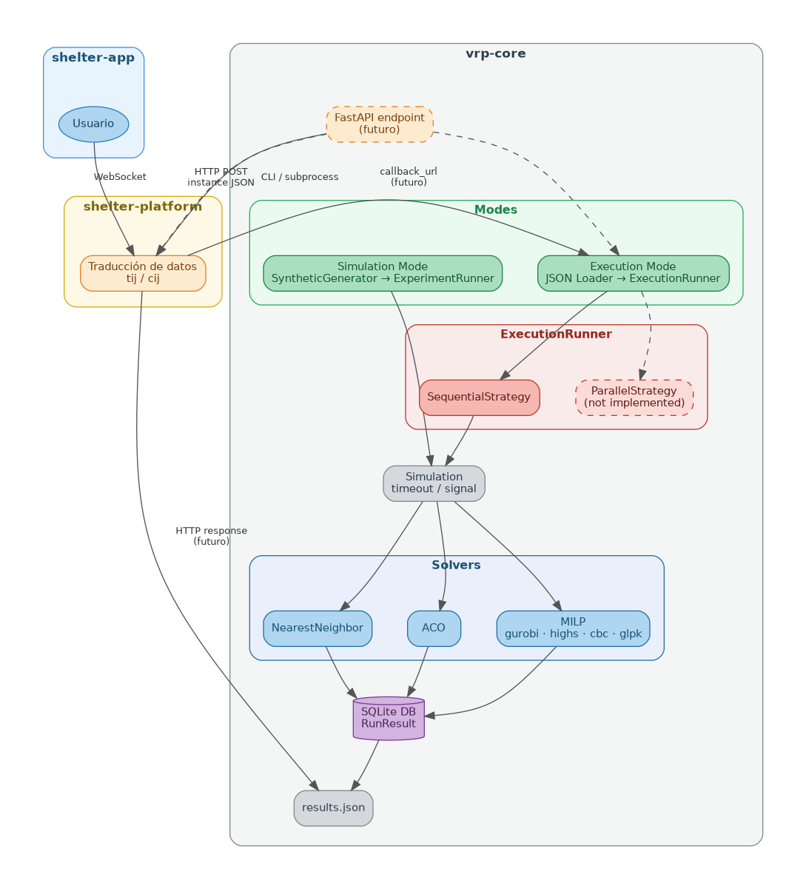

## Tesis: Asignación Óptima de Viajes para Transporte de Maquinaria Agrícola con Restricciones Temporales y Operativas

#### Tomas Marmay ~ Famaf 2025-2026

### Proyecto: Resolución del MD-VRP-TW

Este proyecto implementa y compara distintos enfoques para resolver el **Problema de Ruteo de Vehículos con Múltiples Depósitos y Ventanas de Tiempo (MD-VRP-TW)**.  
El objetivo es construir un **framework experimental modular**, que permita evaluar heurísticas, metaheurísticas y modelos exactos bajo instancias comunes y comparables.


---

### Descripción del problema

El MD-VRP-TW consiste en determinar un conjunto de rutas para una flota de vehículos que:

- parten desde múltiples depósitos  
- deben atender un conjunto de clientes  
- respetan ventanas de tiempo en los clientes  
- regresan a un nodo de retorno (posiblemente distinto del depósito)  
- minimizan el costo total (distancia + penalización por uso de vehículos)

Cada vehículo está asociado a un depósito y, opcionalmente, a un nodo de retorno distinto.

---

### Estructura general del proyecto

El proyecto está organizado por **responsabilidades**, no por algoritmos:
```
data/
models/
solvers/
simulations/
visualizastions/
main.py
```


Cada carpeta cumple un rol bien definido, lo que permite extender el proyecto sin modificar código existente.

---

### models/

Contiene las **estructuras del dominio**, independientes de cualquier algoritmo.

- `problem_instance.py`  
  Representa una instancia fija del MD-VRP-TW.  
  Incluye:
  - clientes, depósitos y returns  
  - matrices de costo y tiempo  
  - ventanas de tiempo  
  - penalización por vehículo  

- `solution.py`  
  Representa una solución producida por cualquier solver.  
  Todas las soluciones tienen el mismo formato:
  - rutas por vehículo  
  - costo total  
  - factibilidad  
  - clientes no atendidos (si existen)  

Estas clases **no contienen lógica de resolución**.

---

### solvers/

Implementa los distintos métodos de resolución.  
Todos los solvers comparten la misma interfaz conceptual: `solve(instance: ProblemInstance) -> Solution`


Solvers implementados:

- **Nearest Neighbor (baseline)**  
  Heurística greedy que asigna clientes y construye rutas respetando restricciones.  
  Sirve como baseline rápida y para detectar casos borde.

- **ACO (Ant Colony Optimization)**  
  Metaheurística basada en colonias de hormigas, adaptada al MD-VRP-TW.  
  Implementa:
  - fase de asignación (cliente → vehículo)
  - fase de ordenamiento de visitas
  - actualización de feromonas  

- **MILP**  
  Modelo exacto de Programación Lineal Entera Mixta.  
  Se utiliza como referencia óptima para instancias pequeñas y para calcular gaps.

Los solvers **no imprimen resultados ni gestionan simulaciones**: solo devuelven soluciones.

---

### simulations/

Contiene la lógica experimental.

- `simulation.py`  
  Implementa la clase `Simulation`, que:
  - recibe una lista de instancias (`ProblemInstance`)
  - recibe una lista de solvers
  - ejecuta todos los solvers sobre todas las instancias
  - recolecta resultados comparables  

Esta capa desacopla completamente:
- definición del problema  
- algoritmos de resolución  
- análisis de resultados  

---

### data/

Contiene **instancias del problema**, no código algorítmico.

Subcarpeta clave:

- `data/instances/`  
  Instancias diseñadas manualmente para:
  - casos borde  
  - validación de factibilidad  
  - debugging  
  - ejemplos explicativos  

Ejemplos de casos borde:
- clientes imposibles de atender por ventanas de tiempo  
- más clientes que capacidad total de vehículos  
- costos nulos o prohibidos entre nodos  
- retornos distintos por vehículo  

---

### visualizations/

Herramientas para análisis y visualización:

- evolución de costos  
- comparación entre solvers  
- rutas construidas  
- convergencia del ACO  

Esta carpeta no interviene en la lógica de resolución.

---

### main.py

Punto de entrada del proyecto.

Responsabilidades:
- cargar instancias desde `data/`
- inicializar solvers
- ejecutar simulaciones
- mostrar resultados resumidos por solver

Ejemplo de salida:
```
Solver: NearestNeighbor
  Costo: 38
  Factible: True
  Rutas: {0: [2, 0, 4], 1: [3, 1, 5]}

Solver: ACO
  Costo: 26
  Factible: True
  Rutas: {3: [3, 1, 0, 5]}

Solver: MILP
  Costo: 24.0
  Factible: True
  Rutas: {2: [2, 0, 3, 1, 4]}

```

### Instalacion

```bash
pip install -r req.txt
sudo apt-get install glpk-utils
sudo apt install python3-pytest
sudo apt install sqlite3 -y
```


```bash
python3 main.py

python -m pytest # Run the full test suite using pytest
python3 -m pytest tests/<file>.py # Run tests from single file
python3 -m pytest tests/<file>.py::<test_fun> # Run single test from single file

# example: python3 -m pytest tests/test_cost.py::test_cost_sum
```

