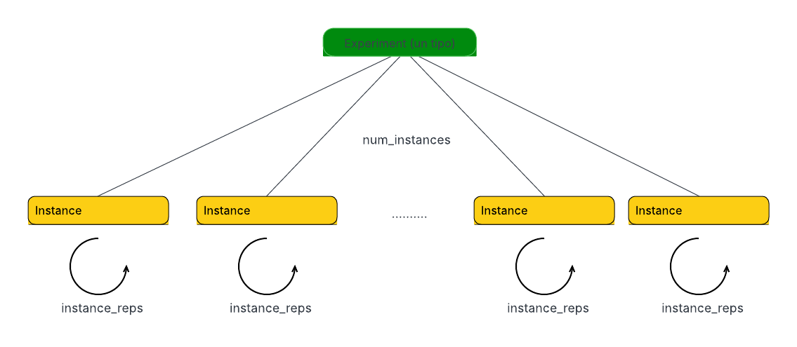

## Aspectos técnicos

Documentación técnica del framework: instalación, arquitectura interna y cómo correr experimentos, ejecuciones puntuales, tests y profiling.

Para una introducción al proyecto y una guía de dónde está cada cosa, ver el [README](../README.md).

---

### Instalación

```bash
pip install -r req.txt
sudo apt install python3-pytest -y
sudo apt install sqlite3 -y

sudo apt install -y postgresql postgresql-contrib
sudo -u postgres createuser $USER # Crear usuario PostgreSQL con el mismo nombre que tu usuario de sistema
sudo -u postgres psql -c "ALTER USER $USER WITH SUPERUSER;" # Dar permisos (opcional pero práctico para desarrollo)
createdb results # Crear la base de datos
psql -l # Verificar que existe

# Milp Solvers
sudo apt-get install glpk-utils -y
sudo apt install coinor-cbc -y
pip install highspy
pip install gurobipy
```

---

### Arquitectura

El proyecto está organizado por **responsabilidades**, no por algoritmos:
```
data/
models/
solvers/
simulations/
analysis/
main.py
```

Cada carpeta cumple un rol bien definido, lo que permite extender el proyecto sin modificar código existente.




#### models/

Contiene las **estructuras del dominio**, independientes de cualquier algoritmo.

- `problem_instance.py`
  Representa una instancia fija del MD-VRP-TW.
  Incluye:
  - clientes, depósitos y returns
  - matrices de costo y tiempo
  - ventanas de tiempo
  - penalización por vehículo

- `solution.py`
  Representa una solución producida por cualquier solver.
  Todas las soluciones tienen el mismo formato:
  - rutas por vehículo
  - costo total
  - factibilidad
  - clientes no atendidos (si existen)

Estas clases **no contienen lógica de resolución**.

#### solvers/

Implementa los distintos métodos de resolución.
Todos los solvers comparten la misma interfaz conceptual: `solve(instance: ProblemInstance) -> Solution`

Solvers implementados:

- **Nearest Neighbor (baseline)**
  Heurística greedy que asigna clientes y construye rutas respetando restricciones.
  Sirve como baseline rápida y para detectar casos borde.

- **ACO (Ant Colony Optimization)**
  Metaheurística basada en colonias de hormigas, adaptada al MD-VRP-TW.
  Implementa:
  - fase de asignación (cliente → vehículo)
  - fase de ordenamiento de visitas
  - actualización de feromonas

- **MILP**
  Modelo exacto de Programación Lineal Entera Mixta.
  Se utiliza como referencia óptima para instancias pequeñas y para calcular gaps.

Los solvers **no imprimen resultados ni gestionan simulaciones**: solo devuelven soluciones.

#### simulations/

Contiene la lógica experimental.

- `simulation.py`
  Implementa la clase `Simulation`, que:
  - recibe una lista de instancias (`ProblemInstance`)
  - recibe una lista de solvers
  - ejecuta todos los solvers sobre todas las instancias
  - recolecta resultados comparables

Esta capa desacopla completamente:
- definición del problema
- algoritmos de resolución
- análisis de resultados

#### data/

Contiene **instancias del problema**, no código algorítmico.

Subcarpeta clave:

- `data/instances/`
  Instancias diseñadas manualmente para:
  - casos borde
  - validación de factibilidad
  - debugging
  - ejemplos explicativos

Ejemplos de casos borde:
- clientes imposibles de atender por ventanas de tiempo
- más clientes que capacidad total de vehículos
- costos nulos o prohibidos entre nodos
- retornos distintos por vehículo

#### analysis/

Notebooks de análisis, separados por etapa:

- `analysis/exploratory/`
  Notebooks de exploración inicial (`research.ipynb`, `results_analysis.ipynb`, `solvers-comparison.ipynb`, `aco_hyperparameter.ipynb`, `twnn.ipynb`, `milp_solvers.ipynb`, `debug_milp_C5_V10.ipynb`).
  Fueron el punto de partida de los análisis y guiaron el diseño de los de `report/`; algunos referencian archivos que ya no existen (`backup.sql`, `results/old_db_results.db`) y no corren tal cual.

- `analysis/report/`
  Notebooks que generaron las figuras y tablas que efectivamente fueron al informe de la tesis (`analysis_aco.ipynb`, `analysis_milp.ipynb`, `analysis_twnn.ipynb`, `analysis_comparison.ipynb`, `analysis_aco_hiper_params.ipynb`), junto con los datasets (`Aco.csv`, `Gurobi.csv`, `HiGHS.csv`, `Twnn.csv`, etc.) y las figuras exportadas (`figures/`).

#### main.py

Punto de entrada del proyecto.

Responsabilidades:
- cargar instancias desde `data/`
- inicializar solvers
- ejecutar simulaciones
- mostrar resultados resumidos por solver

Ejemplo de salida:
```
Solver: NearestNeighbor
  Costo: 38
  Factible: True
  Rutas: {0: [2, 0, 4], 1: [3, 1, 5]}

Solver: ACO
  Costo: 26
  Factible: True
  Rutas: {3: [3, 1, 0, 5]}

Solver: MILP
  Costo: 24.0
  Factible: True
  Rutas: {2: [2, 0, 3, 1, 4]}

```

---

### Ejecutar una instancia puntual

Para correr una sola instancia específica hay dos modos: via JSON o via POST (API).
Ver instrucciones detalladas en [RUNNING_FROM_JSON.md](RUNNING_FROM_JSON.md).

---

### Tests

Ver [TESTS.md](TESTS.md).

---

### Experimentos

Aunque al ejecutar [main.py](../main.py) el experimento se inicia automáticamente con la configuración definida en [conf](../conf/),
también es posible modificar los parámetros según sea necesario para generar el experimento deseado de la siguiente manera utilizando [Hydra](https://hydra.cc/):

```bash
# -m producto carteciano
python main.py -m \
  hydra/launcher=joblib \
  hydra.launcher.n_jobs=4 \
  solvers.aco.alpha=0.5,1 \
  solvers.aco.beta=3,5 \
  solvers.aco.rho=0.2,0.5 \
  'experiments.name=aco_a${solvers.aco.alpha}_b${solvers.aco.beta}_r${solvers.aco.rho}'
```

### Profiling

```bash
pip install py-spy
sudo env "PATH=$PATH" py-spy top --pid 19220
py-spy record -o profile.svg -- python tu_script.py
psql -U tmarmay -h localhost -d results
```
